<a id="top"></a>

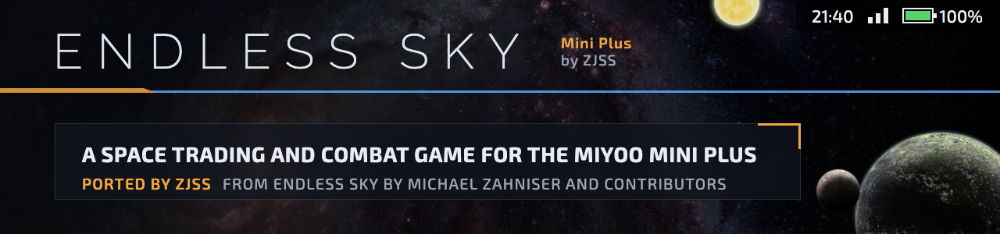

The full [Endless Sky](https://github.com/endless-sky/endless-sky) on the Miyoo Mini Plus, **ported
by ZJSS**. Endless Sky is an open-source space game in the spirit of Escape Velocity: you start
with a small ship and a few credits, then trade, take missions, mine asteroids, fight pirates,
buy better ships and build a fleet, while a long story plays out across the galaxy. This port
runs all of it under Onion OS, on a 640x480 screen with no GPU, mouse or keyboard.

**Whole campaign · 30 fps flight · every action on a button · on-screen keyboard · status bar · Onion game switcher**

[](https://github.com/zakijss/EndlessSky/releases/latest) [](https://github.com/OnionUI/Onion) [](https://github.com/OnionUI/Onion) [](https://github.com/endless-sky/endless-sky) [](../license.txt)

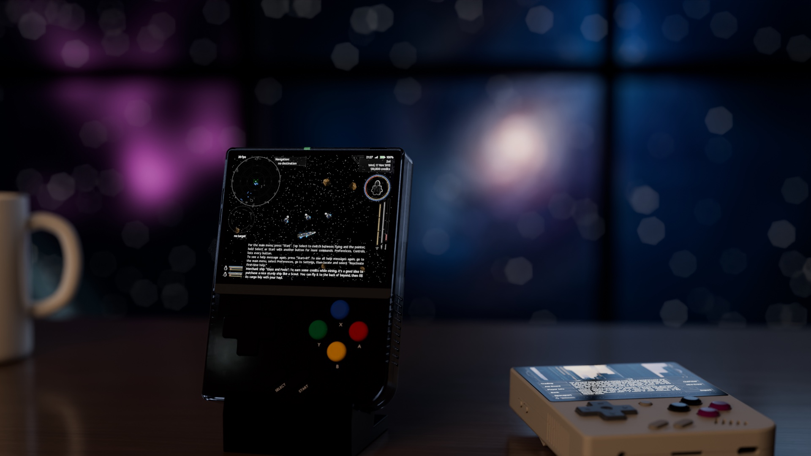

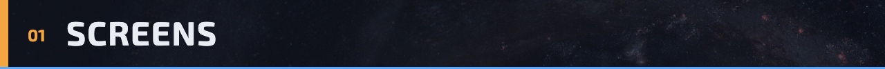

<p align="center">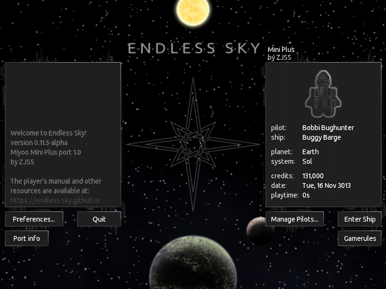 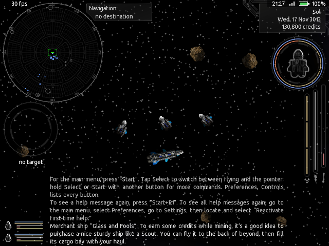</p>
<p align="center">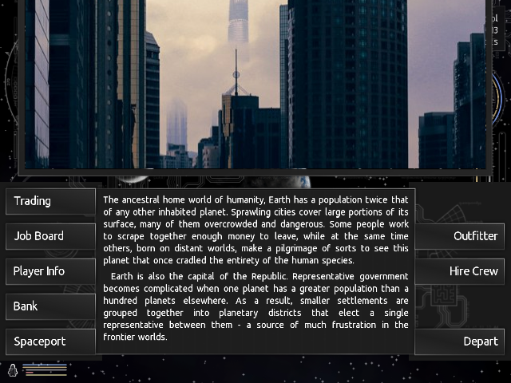 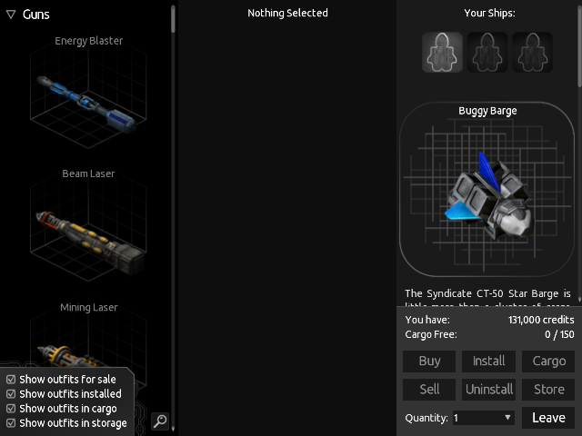</p>
<p align="center">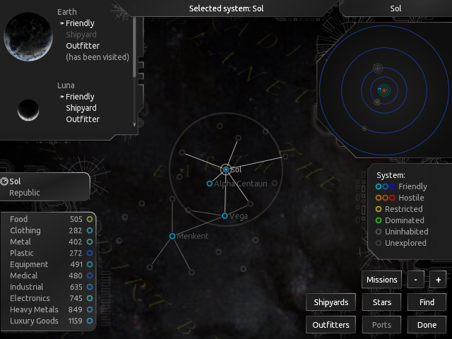 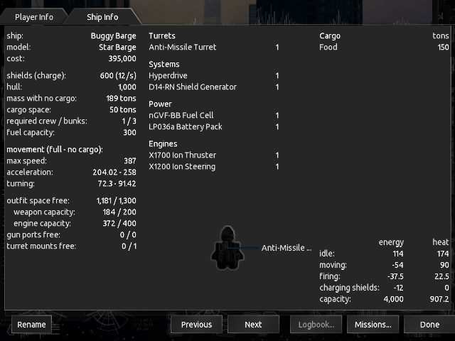</p>

The flight picture is a screen grab from a Miyoo Mini Plus. The others come from the same renderer
on a computer, at the Miyoo's resolution. The two room pictures are Blender renders with those
screens on the devices.

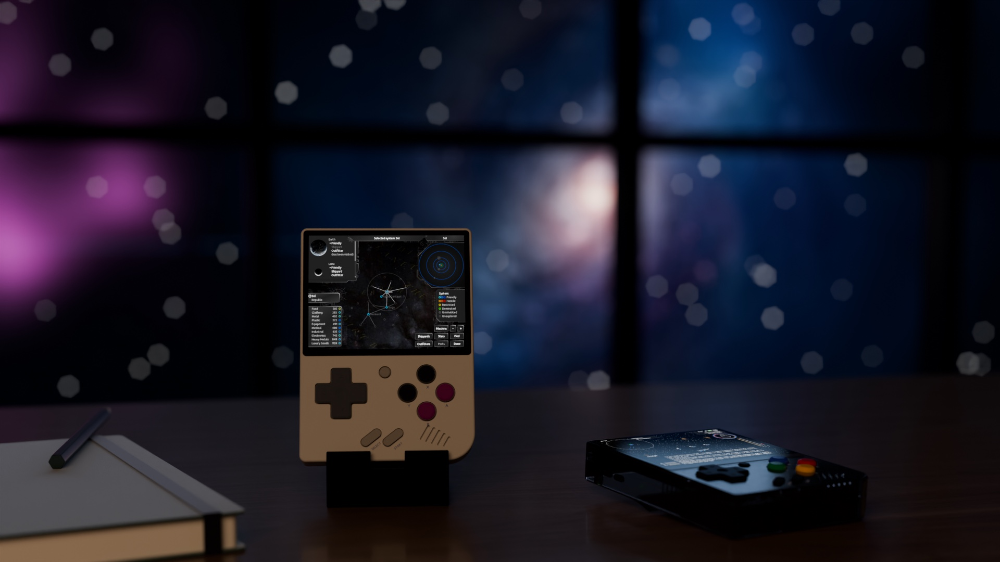

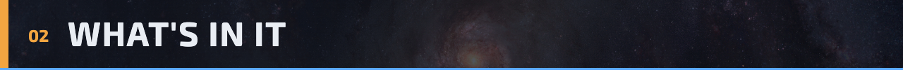

- **The whole game.** Every story line, ship, outfit, government and mission from upstream Endless
  Sky, with trading, mining, boarding, fleets, escorts and the galaxy map. Nothing is cut or
  simplified. The game data is upstream's; only help texts that name keyboard keys are reworded.
- **Saves that travel.** The save format is the PC game's. Copy a pilot from your computer to the
  SD card and keep playing, or take a Miyoo pilot back to the PC.
- **A renderer made for the Miyoo.** The Mini Plus has no graphics chip, so the port draws every
  frame on the CPU with fixed-point maths. Open space runs at 30 frames a second, and in busy
  fights and hyperspace the game keeps full speed by drawing fewer frames instead of slowing down.
- **Screens that fit.** Every menu and planet screen is laid out again for the small screen
  (800x600 logical pixels shown on the 640x480 panel). Shops, the job board, the map, the ship and
  player pages and the conversation screens were all checked so their text and buttons stay on
  screen. Text uses the game's full-size font atlas, so it stays sharp.
- **Controls for the buttons you have.** Flying uses the D-pad, face buttons and shoulders.
  Holding Select or Start gives a second set of commands. Menus use a pointer you move with the
  D-pad, and an on-screen keyboard opens when the game asks for a name. The game's help messages
  and tutorials name the Miyoo's buttons instead of keyboard keys.
- **A status bar.** Time, Wi-Fi and battery sit in the top-right corner, as on Onion's own
  screens. An optional frame counter sits at the top left (Preferences, Settings, Show frame rate).
- **Port info page.** Main menu, Port info: the version, every control and tips for playing on the
  Miyoo, on a page you can scroll.
- **Sound.** All of the game's sound effects and its ambient loops. Endless Sky has no music.
- **Onion's game switcher.** The Menu button belongs to Onion and opens the game switcher. Leaving
  that way is like quitting: progress since your last landing is lost, as in the PC game, so land
  first.
- **Kept up to date.** This fork follows upstream Endless Sky. New ships, missions and fixes from
  upstream come in by merge, and each release says which upstream version it is built on.

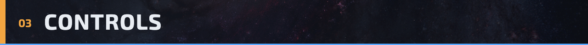

Flying:

| Button | Action | Button | Action |
| --- | --- | --- | --- |
| Up / Down | Thrust / reverse | L1 | Land |
| Left / Right | Turn | R1 | Hyperspace jump |
| A | Fire primary weapons | L2 | Star map |
| B | Fire secondary weapon | R2 | Board the target |
| X | Afterburner | Start | Main menu |
| Y | Target nearest enemy | Select (tap) | Switch to the pointer |

Hold Select and press:

| Button | Action | Button | Action |
| --- | --- | --- | --- |
| A | Hail the target | Up | Fleet: fight my target |
| B | Next secondary weapon | Down | Fleet: gather around me |
| X | Deploy or recall fighters | Left | Fleet: hold position |
| Y | Next ship | Right | Fleet: toggle hold fire |
| L1 | Scan the target | L2 | Message log |
| R1 | Auto steer | R2 | Nearest asteroid |
| Start | Fast-forward | | |

Hold Start and press:

| Button | Action | Button | Action |
| --- | --- | --- | --- |
| Y | Player info | L1 | Pause |
| A | Cloak | R1 | Help |
| B | Fleet: harvest flotsam | X | Fleet: use ammo or not |

**Pointer (menus and planets).** Tap Select to switch between flying and the pointer; landing and
taking off switch for you. The D-pad moves the pointer (a tap nudges it, holding speeds it up). A
clicks, X right-clicks, B goes back and Start confirms. L1 and R1 scroll, L2 and R2 page up and
down, and Select with the D-pad sends the arrow keys. Hold Select or Start while you click to buy
or sell 5 or 20 at a time (both together: 100), or to add ships to a selection.

**Keyboard.** When the game asks for text (your pilot's name, a ship's name, a map search) a
keyboard opens at the top of the screen. The D-pad picks a key, A types it, B deletes, X is Shift,
Start is done, L2 and R2 scroll the text behind it and Y hides it. In pointer mode, Y brings it
back.

Every binding is also listed in the game under Preferences, Controls.

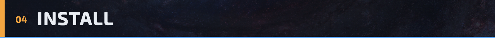

1. Download `EndlessSky-Miyoo-<version>.zip` from
   [Releases](https://github.com/zakijss/EndlessSky/releases/latest).
2. Unzip it and copy its `Roms` folder to the root of the SD card, merging it with the `Roms`
   folder already there.
3. On the Miyoo, open Games, then Ports, then the Space genre, and start Endless Sky. If it isn't
   listed, refresh the game list from the Ports menu.

The game takes about 200 MB on the card and starts in about 5 seconds.

**Saves.** They live in `Saves/CurrentProfile/saves/EndlessSky` on the SD card, with your settings
and a log of the last run (`last-run.log`). The game saves whenever you land, as the PC version
does.

**Moving a pilot from a PC.** Copy the pilot's `.txt` files from the game's `saves` folder on the
computer (`~/.local/share/endless-sky/saves` on Linux, `%APPDATA%\endless-sky\saves` on Windows,
`~/Library/Application Support/endless-sky/saves` on a Mac) into
`Saves/CurrentProfile/saves/EndlessSky/saves` on the card. A save from an older version of the
game loads here; a save from this port loads on a PC running the same or a newer version.

**Updating.** Copy a newer release over the old one. Saves and settings are kept. What changed in
each version is in the [changelog](../miyoo/CHANGELOG.md).

**Removing it.** Delete `Roms/PORTS/Games/Endless Sky`, `Roms/PORTS/Shortcuts/Space/Endless Sky.port`
and `Roms/PORTS/Imgs/Endless Sky.png`. Your saves stay in the `Saves` folder until you delete them.

**Known limits**

- Made and tested on the Miyoo Mini Plus. Other Miyoo models are untested.
- Texture filtering (smoother sprites) and motion blur look nicer but cost a lot of speed. They
  are in Preferences, Settings, and start off.
- Large battles and planet screens run nearer 20 frames a second. The game keeps its speed by
  drawing fewer frames.
- Plugins load from `Saves/CurrentProfile/saves/EndlessSky/plugins`, but big ones with lots of art
  may not fit in the Miyoo's memory.

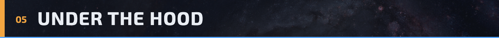

The Mini Plus has a dual-core ARM Cortex-A7 at 1.2 GHz, 128 MB of memory and no GPU. Endless Sky
is written for OpenGL, so the port replaces the graphics layer and leaves the game itself alone.

- **Software renderer** (`source/soft/`). The OpenGL shaders the game uses (sprites, text, rings,
  lines, outlines, the map fog and the starfield) are rewritten for the CPU: fixed-point sprite
  drawing with fast paths for unrotated sprites, cached glyphs and ship outlines, and row spans for
  rings and stars. Frames go straight to the framebuffer.
- **Frame pacing.** The game logic runs 60 steps a second. When drawing can't keep up in flight,
  up to three steps run between drawn frames, so time in the game stays real. Outside flight an
  unchanged screen is shown again instead of drawn again.
- **Memory.** Sprites load when they are first drawn and are dropped, least recently used first,
  once 20 MB of pictures are in memory. Their sizes come from a list shipped with the game, so
  start-up doesn't open every image. Sounds load on first play, as mono, into a 6 MB cache.
- **Art.** Ship and effect art ships at 0.625 of its original size, and pictures always shown at
  their own size (planets, outfits, portraits, the interface) at 0.8; both are the sizes they are
  drawn at. The few huge backgrounds are capped at 1024 or 1280 pixels.
- **Layouts.** A script rewrites the game's interface files for the small screen each time the
  game is updated, so upstream changes come through and only the positions differ.

Measured on a Miyoo Mini Plus:

| | Frames a second | Game speed |
| --- | --- | --- |
| Flying in open space | 30 | 100% |
| Busy systems and hyperspace | 20 | 100% |
| Main menu and pilot list | 30 | |
| Planet screens and shops | 20 | |
| Star map | 20 to 30 | |

The game uses about 50 MB of memory plus about 25 MB of swap.

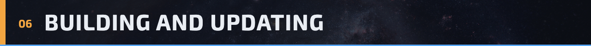

Builds run in Docker on any computer. One image cross-compiles for the Miyoo; the other builds a
desktop version of the same renderer for tests and screenshots. From a fresh clone:

```sh
docker build -t es-zig -f miyoo/Dockerfile miyoo
docker build -t es-host -f miyoo/Dockerfile.host miyoo
docker run --rm -v "$PWD:/es" -w /es es-zig sh miyoo/deps.sh
docker run --rm -v "$PWD:/es" -w /es es-zig sh -c 'cmake -G Ninja -B build-arm \
  -DCMAKE_BUILD_TYPE=Release -DCMAKE_TOOLCHAIN_FILE=/es/miyoo/cross/toolchain.cmake \
  -DES_SOFT=ON -DES_MIYOO=ON -DES_USE_VCPKG=OFF -DBUILD_TESTING=OFF &&
  ninja -C build-arm -j2 &&
  arm-linux-gnueabihf-strip -o build-miyoo/endless-sky build-arm/endless-sky &&
  miyoo/tools/stage.sh'
docker run --rm -v "$PWD:/es" -w /es es-host sh miyoo/tools/art.sh
```

`build-miyoo/stage` is then the SD card package. [miyoo/UPDATING.md](../miyoo/UPDATING.md) has
the rest: merging from upstream, the tests that must pass (the game's 45 integration tests and the
renderer and sound self-checks), redoing the art data when upstream art changes, screen tours for
checking layouts, and making a release.

Where the port's work lives:

- `source/soft/`: the renderer, the Miyoo window (framebuffer, buttons, keyboard, status bar,
  frame pacing) and the Port info page.
- `#ifdef ES_SOFT` and `ES_MIYOO` blocks: the port's changes inside upstream source files.
- `miyoo/data/_ui/`: text the port replaces (colours, help messages, the Port info page).
- `miyoo/art/`: sprite sizes, collision masks and areas made from the art.
- `miyoo/tools/`: layout and help generators, image tools, `stage.sh` and `art.sh`.
- `miyoo/onion/`: the Onion launcher and its list picture.
- `miyoo/tests/`: renderer and sound self-checks, and screen tours.

Problems with the port go in this repo's [issues](https://github.com/zakijss/EndlessSky/issues).
Problems with the game itself (missions, balance, story) belong upstream at
[endless-sky/endless-sky](https://github.com/endless-sky/endless-sky/issues).

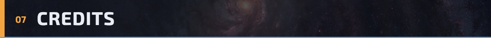

- Port: ZJSS (renderer, layouts, controls, status bar, Port info page and the Onion launcher).
- Endless Sky: created by Michael Zahniser and developed by its contributors, listed in
  [credits.txt](../credits.txt). The game is free software under the GNU General Public License
  version 3, and so is this port.
- Art and sound: by many artists, under the licences listed in [copyright](../copyright). The
  banner and section headers here are made from the game's own art (the galaxy map and the main
  menu planets), and so is the view out of the window in the room renders, which use Poly Haven
  textures (CC0).
- Onion OS: the launcher uses Onion's `launch_standalone.sh`, and Menu opens Onion's game switcher.
- Fonts in the headers: Exo 2 (Natanael Gama) and Raleway (Matt McInerney, Pablo Impallari and
  Rodrigo Fuenzalida), under the SIL Open Font License.

<a href="https://github.com/zakijss/EndlessSky/releases/latest">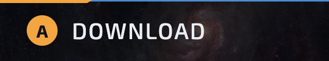</a><a href="#top">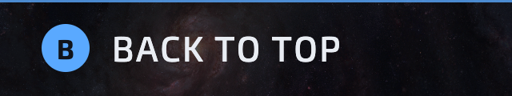</a>
