<a id="top"></a>

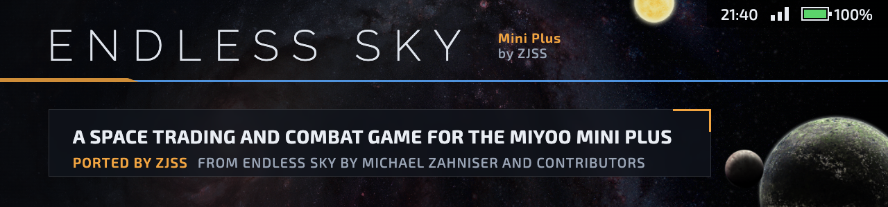

The full [Endless Sky](https://github.com/endless-sky/endless-sky) on the Miyoo Mini Plus, **ported
by ZJSS**. Start with a small ship and a few credits, then trade, take missions, mine asteroids,
fight pirates and build a fleet while a long story plays out across the galaxy. It runs under
Onion OS on a 640x480 screen with no GPU, mouse or keyboard.

**Whole campaign · 30 fps flight · D-pad menus · rumble · every action on a button · on-screen keyboard · status bar · Onion game switcher**

[](https://github.com/zakijss/EndlessSky/releases/latest) [](https://github.com/OnionUI/Onion) [](https://github.com/OnionUI/Onion) [](https://github.com/endless-sky/endless-sky) [](../license.txt)

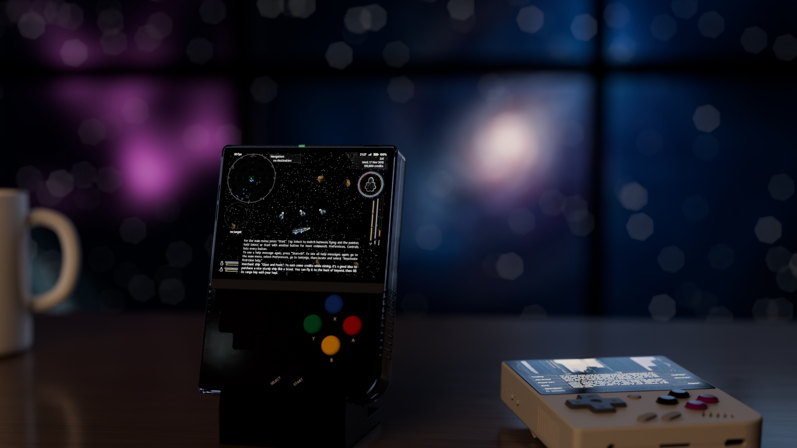

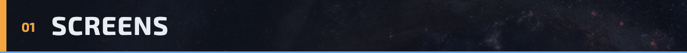

<p align="center">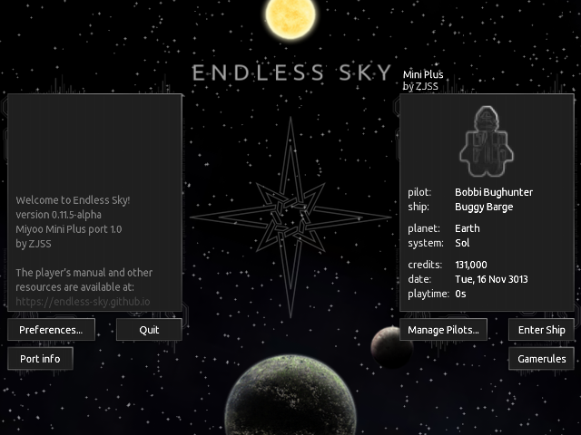 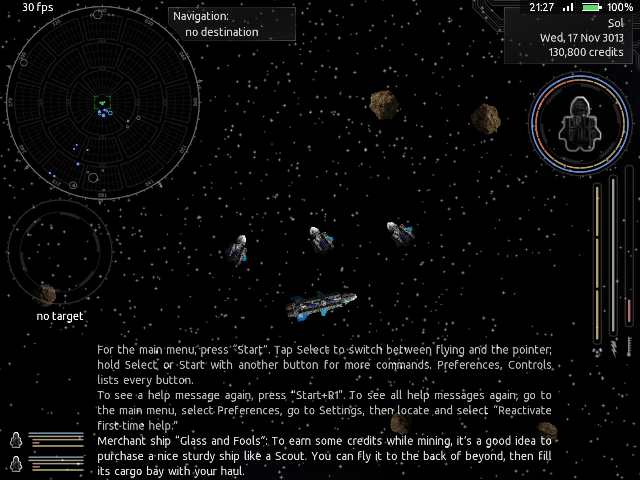</p>
<p align="center">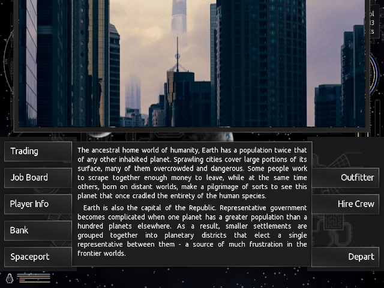 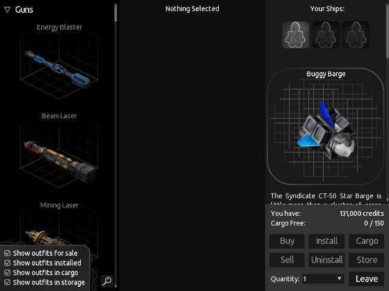</p>
<p align="center">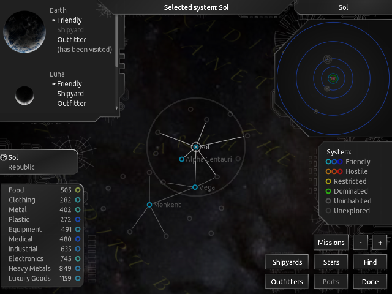 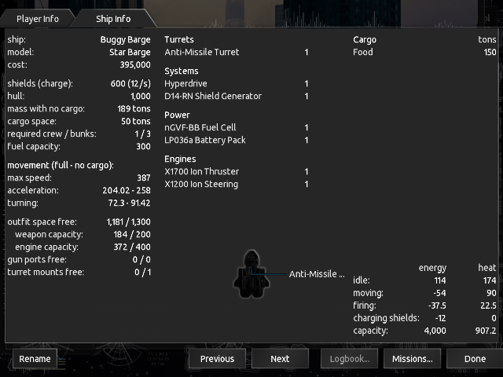</p>
<p align="center"><sub>The flight picture is a screen grab from the Miyoo; the others come from the same renderer on a computer, at the Miyoo's resolution.</sub></p>

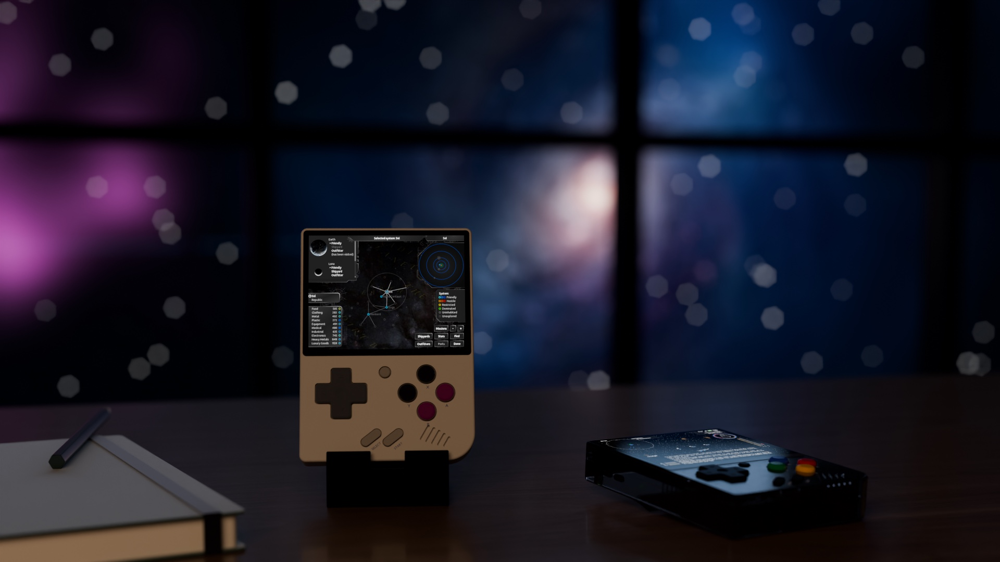

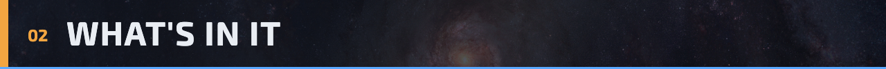

- **The whole game:** every story line, ship, outfit and mission from upstream, nothing cut. Only
  help texts that name keyboard keys are reworded, to name the Miyoo's buttons.
- **PC saves:** the save format is the PC game's, so a pilot moves between the computer and the
  Miyoo in either direction.
- **A CPU renderer:** 30 frames a second in open space; in busy fights the game keeps full speed by
  drawing fewer frames.
- **Screens that fit:** every menu and planet screen is laid out again for the small screen, with
  sharp text.
- **Button controls:** the D-pad jumps between buttons and rows in menus, holding Select or Start
  gives a second set of commands (hold a moment to see them), and an on-screen keyboard opens for
  names.
- **Made for a handheld:** rumble, battery warnings at 15% and 5%, save anywhere in flight
  (Start+R2), a battery saver, screen dimming, and a status bar with the time,
  Wi-Fi and battery. All of these are in Preferences, Settings, on the last page.
- **Updates itself** over Wi-Fi from signed releases, and follows upstream Endless Sky by merge.

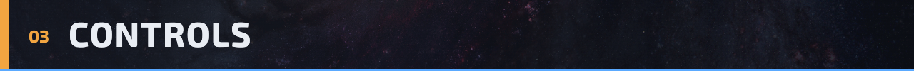

| Button | Action | Button | Action |
| --- | --- | --- | --- |
| Up / Down | Thrust / reverse | L1 | Land |
| Left / Right | Turn | R1 | Hyperspace jump |
| A | Fire primary weapons | L2 | Star map |
| B | Fire secondary weapon | R2 | Board the target |
| X | Afterburner | Start | Main menu |
| Y | Target nearest enemy | Select (tap) | Switch to the pointer |

Every binding is also listed in the game under Preferences, Controls, and on the Port info page.

<details>
<summary><b>Hold Select, hold Start, the pointer and the keyboard</b></summary>

Hold Select and press:

| Button | Action | Button | Action |
| --- | --- | --- | --- |
| A | Hail the target | Up | Fleet: fight my target |
| B | Next secondary weapon | Down | Fleet: gather around me |
| X | Deploy or recall fighters | Left | Fleet: hold position |
| Y | Next ship | Right | Fleet: toggle hold fire |
| L1 | Scan the target | L2 | Message log |
| R1 | Auto steer | R2 | Nearest asteroid |
| Start | Fast-forward | | |

Hold Start and press:

| Button | Action | Button | Action |
| --- | --- | --- | --- |
| Y | Player info | L1 | Pause |
| A | Cloak | R1 | Help |
| B | Fleet: harvest flotsam | X | Fleet: use ammo or not |
| Up | Fleet jump | Down | Fleet: scan my target |
| Left | Turret tracking on or off | R2 | Save here (in flight) |

**Pointer (menus and planets).** Tap Select to switch between flying and the pointer; landing and
taking off switch for you. The D-pad jumps the pointer to the next button or row, outlined in
orange (hold to keep going). On the map, or where nothing more is that way, it moves freely. A
clicks, X right-clicks, B goes back and Start confirms. L1 and R1 scroll, L2 and R2 page up and
down, and Select with the D-pad sends the arrow keys. Start with B centres the map on your system;
hold Start while moving for a slow pointer. Hold Select or Start while you click to buy or sell 5
or 20 at a time (both together: 100), or to add ships to a selection.

**Keyboard.** The D-pad picks a key, A types it, B deletes, X is Shift, Start is done, L2 and R2
scroll the text behind it and Y hides it. In pointer mode, Y brings it back.

</details>

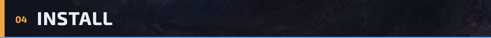

Open **Ports** in [MiniMart](https://github.com/zakijss/MiniMart): Endless Sky is at the top,
signed. Or download `EndlessSky-Miyoo-<version>.zip` from the
[latest release](https://github.com/zakijss/EndlessSky/releases/latest) and copy its `Roms` folder
onto the SD card, merging it with the one there. Needs Onion OS; the game is in Games, Ports,
Space, takes about 200 MB and starts in about 5 seconds.

Once a day, when you start it, the game looks for a newer release; the main menu then says so
under Port info, where Download fetches a few MB (only what changed). An update is installed only
if it is newer and its signature checks out with the release key; saves and settings are kept.
What changed is in the [changelog](../miyoo/CHANGELOG.md).

<details>
<summary><b>Saves, moving a pilot from a PC, removing it, known limits</b></summary>

**Saves** are in `Saves/CurrentProfile/saves/EndlessSky` on the SD card, with your settings and a
log of the last run (`last-run.log`). The game saves whenever you land, and by default also when
you leave it in flight (Menu, a flat battery, Onion's sleep); turn "Save in flight" off for the PC
rule. Saves are written to a temporary file and renamed into place.

**From a PC,** copy the pilot's `.txt` files from the game's `saves` folder
(`~/.local/share/endless-sky/saves` on Linux, `%APPDATA%\endless-sky\saves` on Windows,
`~/Library/Application Support/endless-sky/saves` on a Mac) into
`Saves/CurrentProfile/saves/EndlessSky/saves` on the card. A save from an older version loads here;
a save from this port loads on a PC running the same or a newer version.

**To remove it,** delete `Roms/PORTS/Games/Endless Sky`, `Roms/PORTS/Shortcuts/Space/Endless Sky.port`
and `Roms/PORTS/Imgs/Endless Sky.png`. Your saves stay in `Saves` until you delete them.

**Known limits**

- Made and tested on the Miyoo Mini Plus. Other Miyoo models are untested.
- Motion blur (Preferences, Settings, off by default) costs a lot of speed. Sprite smoothing
  ("auto") switches off by itself in the heaviest scenes.
- Large battles and planet screens run nearer 20 frames a second.
- Plugins load from `Saves/CurrentProfile/saves/EndlessSky/plugins`, but big ones with lots of art
  may not fit in the Miyoo's memory.

</details>

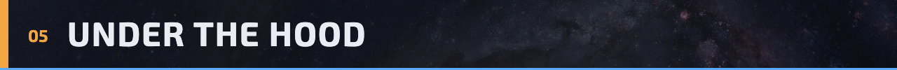

The Mini Plus has a dual-core ARM Cortex-A7 at 1.2 GHz, 128 MB of memory and no GPU. Endless Sky
is written for OpenGL, so the port replaces the graphics layer and leaves the game itself alone.

- **Software renderer** (`source/soft/`): the game's OpenGL shaders rewritten for the CPU, in
  fixed point, on both cores, with NEON for blending and smooth sampling. Frames go straight to
  the framebuffer.
- **Art:** ships and effects ship at 0.625 of their original size, and pictures shown at their own
  size (planets, outfits, portraits, the interface) at 0.8. Ships, planets, asteroids and effects
  also come at 0.4, 0.56 and 0.8, loaded to match the view zoom.
- **Frame pacing:** the game logic runs 60 steps a second; when drawing can't keep up in flight,
  up to three steps run between drawn frames, so game time stays real.
- **Memory:** sprites load when first drawn and the least recently used are dropped past 20 MB;
  sounds load on first play, as mono, into a 6 MB cache. The game uses about 50 MB plus about
  25 MB of swap.
- **Layouts:** a script rewrites the game's interface files for an 800x600 screen (drawn at 0.8)
  each time upstream is merged, so only the positions differ.

<details>
<summary><b>Measured on a Miyoo Mini Plus</b></summary>

| | Frames a second | Game speed |
| --- | --- | --- |
| Flying in open space | 30 | 100% |
| Busy systems and hyperspace | 20 | 100% |
| Main menu and pilot list | 30 | |
| Planet screens and shops | 20 | |
| Star map | 20 to 30 | |

</details>

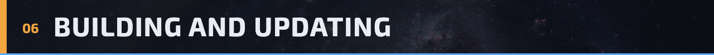

Builds run in Docker on any computer: one image cross-compiles for the Miyoo, the other builds a
desktop version of the same renderer for tests and screenshots.
[miyoo/UPDATING.md](../miyoo/UPDATING.md) covers merging from upstream, the tests that must pass,
redoing the art and making a release. Problems with the port go in this repo's
[issues](https://github.com/zakijss/EndlessSky/issues); problems with the game itself (missions,
balance, story) belong [upstream](https://github.com/endless-sky/endless-sky/issues).

<details>
<summary><b>Build commands and where the port's work lives</b></summary>

From a fresh clone:

```sh
docker build -t es-zig -f miyoo/Dockerfile miyoo
docker build -t es-host -f miyoo/Dockerfile.host miyoo
docker run --rm -v "$PWD:/es" -w /es es-zig sh miyoo/deps.sh
docker run --rm -v "$PWD:/es" -w /es es-zig sh -c 'cmake -G Ninja -B build-arm \
  -DCMAKE_BUILD_TYPE=Release -DCMAKE_TOOLCHAIN_FILE=/es/miyoo/cross/toolchain.cmake \
  -DES_SOFT=ON -DES_MIYOO=ON -DES_USE_VCPKG=OFF -DBUILD_TESTING=OFF &&
  ninja -C build-arm -j2 &&
  arm-linux-gnueabihf-strip -o build-miyoo/endless-sky build-arm/endless-sky &&
  miyoo/tools/stage.sh'
docker run --rm -v "$PWD:/es" -w /es es-host sh miyoo/tools/art.sh
```

`build-miyoo/stage` is then the SD card package.

- `source/soft/`: the renderer, the Miyoo window (framebuffer, buttons, keyboard, status bar,
  frame pacing) and the Port info page.
- `#ifdef ES_SOFT` and `ES_MIYOO` blocks: the port's changes inside upstream source files.
- `miyoo/data/_ui/`: text the port replaces (colours, help messages, the Port info page).
- `miyoo/art/`: sprite sizes, collision masks and areas made from the art.
- `miyoo/tools/`: layout and help generators, image tools, `stage.sh` and `art.sh`.
- `miyoo/onion/`: the Onion launcher and its list picture.
- `miyoo/tests/`: renderer and sound self-checks, and screen tours.

</details>

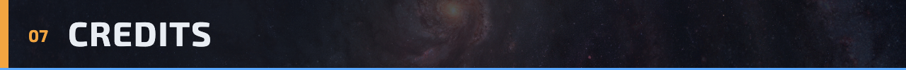

- Port: ZJSS (renderer, layouts, controls, status bar, Port info page and the Onion launcher).
- Endless Sky: created by Michael Zahniser and developed by its contributors, listed in
  [credits.txt](../credits.txt). The game is free software under the GNU General Public License
  version 3, and so is this port.
- Art and sound: by many artists, under the licences listed in [copyright](../copyright). The
  banner and section headers here are made from the game's own art (the galaxy map and the main
  menu planets), and so is the view out of the window in the room renders, which use Poly Haven
  textures (CC0).
- Onion OS: the launcher uses Onion's `launch_standalone.sh`; Menu, the low-battery exit, rumble
  (GPIO 48) and staying awake follow Onion's own code and flag files.
- Fonts in the headers: Exo 2 (Natanael Gama) and Raleway (Matt McInerney, Pablo Impallari and
  Rodrigo Fuenzalida), under the SIL Open Font License.

<a href="https://github.com/zakijss/EndlessSky/releases/latest">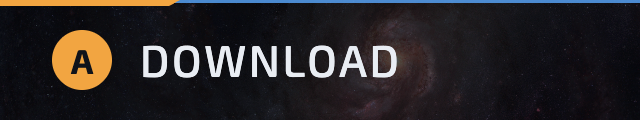</a><a href="#top">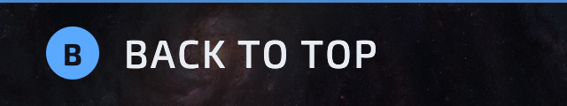</a>
